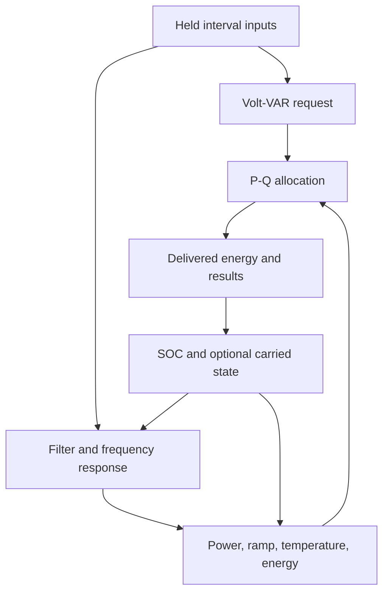

# Architecture

[Handbook](../INDEX.md) · [Native model guide](../../models/README.md)

## Four cooperating content layers

| Layer | Actual responsibility | Boundary |
|---|---|---|
| `models/` | Standard-library Python functions, frozen result/configuration dataclasses, strict CSV inputs and CLIs | Static or held-input interval references; no plant I/O or dynamic network solver |
| `tests/` | 153 source-defined unittest methods with deterministic examples, rejection cases and sweeps | Implementation evidence; no measured equipment calibration |
| `concepts/`, `checklists/`, `glossary/`, `diagrams/` | Explain concepts and request project evidence | Review prompts, not a controller or approval workflow |
| `docs/` | Standalone teaching lab, source-linked guide, catalog and preserved presentation assets | Browser calculations do not call the Python models |

Native imports and composition are explicit. The module/script import fallback supports both package imports and direct file execution. The portfolio validator checks paths, embedded JSON equality and one SVG; it does not execute the native models. [models/grid_support_sequence.py](https://github.com/mohammadrezwankhan/smart-grid-storage-playbook/blob/8bf7dd1d4cc1899dfc9fbb034f1fb3c35bd9763e/models/grid_support_sequence.py#L1-L52) [scripts/portfolio/validate_guide.py](https://github.com/mohammadrezwankhan/smart-grid-storage-playbook/blob/8bf7dd1d4cc1899dfc9fbb034f1fb3c35bd9763e/scripts/portfolio/validate_guide.py#L1-L33)

## Native composition and carried state

`simulate_grid_support_sequence` validates nonempty equal-length frequency, voltage, baseline and duration profiles. Each interval derives a Volt-VAR Q request and a frequency-watt P request, then invokes the ordered constraints. SOC is carried from **delivered** post-capability power; optional ramp/filter states carry delivered P and filtered frequency. [models/grid_support_sequence.py](https://github.com/mohammadrezwankhan/smart-grid-storage-playbook/blob/8bf7dd1d4cc1899dfc9fbb034f1fb3c35bd9763e/models/grid_support_sequence.py#L98-L272)

The frequency path is optional measurement filter → frequency adjustment plus baseline → nameplate bound → optional ramp → optional hard temperature envelope → optional interval-energy bound → P–Q capability → delivered-energy recomputation. This order is a policy: downstream hard limits can reduce delivered P beyond the earlier ramp target. The result retains stage records so the reason is inspectable. [models/frequency_watt.py](https://github.com/mohammadrezwankhan/smart-grid-storage-playbook/blob/8bf7dd1d4cc1899dfc9fbb034f1fb3c35bd9763e/models/frequency_watt.py#L191-L320)

The reserve path is separate. It calculates feasible replacement endpoints around a baseline while preserving a fixed reactive obligation, then the sequence audit evaluates reserve at each interval start and advances **baseline** SOC. It does not activate every reserve call or optimize a future dispatch schedule. [models/reserve_headroom.py](https://github.com/mohammadrezwankhan/smart-grid-storage-playbook/blob/8bf7dd1d4cc1899dfc9fbb034f1fb3c35bd9763e/models/reserve_headroom.py#L75-L214) [models/reserve_sequence.py](https://github.com/mohammadrezwankhan/smart-grid-storage-playbook/blob/8bf7dd1d4cc1899dfc9fbb034f1fb3c35bd9763e/models/reserve_sequence.py#L123-L220)

## Native data contracts

The circular P–Q boundary is a positive MVA scalar. Sampled symmetric curves use a strictly increasing P axis, strictly decreasing Q magnitude, axis endpoints and concavity; directional envelopes require all four quadrants and consistent shared axes. Temperature CSVs use strictly increasing temperatures and nonnegative independent charge/discharge limits, with endpoint clamping. [models/pq_capability.py](https://github.com/mohammadrezwankhan/smart-grid-storage-playbook/blob/8bf7dd1d4cc1899dfc9fbb034f1fb3c35bd9763e/models/pq_capability.py#L45-L260) [models/pq_capability.py](https://github.com/mohammadrezwankhan/smart-grid-storage-playbook/blob/8bf7dd1d4cc1899dfc9fbb034f1fb3c35bd9763e/models/pq_capability.py#L510-L605) [models/temperature_derating.py](https://github.com/mohammadrezwankhan/smart-grid-storage-playbook/blob/8bf7dd1d4cc1899dfc9fbb034f1fb3c35bd9763e/models/temperature_derating.py#L49-L124)

The three committed CSVs are illustrative test inputs. They are not manufacturer ratings or site measurements. Native state is supplied explicitly; there is no hidden database, persisted schedule or environment-variable configuration loader.

## Browser and guide responsibilities

The active `grid` teaching branch computes a synthetic solar/demand balance with fixed battery power in kW. It omits SOC, charging schedules, P–Q capability, frequency, voltage and dynamic grid control. Its generic engine default for `batteryKW` is 100, while the selected lesson configuration initializes it to 0; the UI uses the configured defaults and presets. [docs/index.html](https://github.com/mohammadrezwankhan/smart-grid-storage-playbook/blob/8bf7dd1d4cc1899dfc9fbb034f1fb3c35bd9763e/docs/index.html#L199-L204) [docs/index.html](https://github.com/mohammadrezwankhan/smart-grid-storage-playbook/blob/8bf7dd1d4cc1899dfc9fbb034f1fb3c35bd9763e/docs/index.html#L253-L288) [docs/lesson-config.json](https://github.com/mohammadrezwankhan/smart-grid-storage-playbook/blob/8bf7dd1d4cc1899dfc9fbb034f1fb3c35bd9763e/docs/lesson-config.json#L51-L144)

The shared embedded engine exposes ten model kinds; the other nine remain callable generic demonstrations, not additional native storage features. `LabSimulation` exports model specs/evaluation/checkpoint helpers; `LabDashboard` exposes a state snapshot and two engine aliases. UI controls change local state, export 241 synthetic CSV samples or copy/download embedded configuration. [docs/index.html](https://github.com/mohammadrezwankhan/smart-grid-storage-playbook/blob/8bf7dd1d4cc1899dfc9fbb034f1fb3c35bd9763e/docs/index.html#L165-L177) [docs/index.html](https://github.com/mohammadrezwankhan/smart-grid-storage-playbook/blob/8bf7dd1d4cc1899dfc9fbb034f1fb3c35bd9763e/docs/index.html#L338-L353) [docs/index.html](https://github.com/mohammadrezwankhan/smart-grid-storage-playbook/blob/8bf7dd1d4cc1899dfc9fbb034f1fb3c35bd9763e/docs/index.html#L460-L488)

The portfolio guide uses local browser storage for study progress/notes and can export a study plan. That content is separate from physical model state. Historical catalog and artwork files retain their original provenance. [docs/portfolio/index.html](https://github.com/mohammadrezwankhan/smart-grid-storage-playbook/blob/8bf7dd1d4cc1899dfc9fbb034f1fb3c35bd9763e/docs/portfolio/index.html#L270-L296) [docs/native-lessons.json](https://github.com/mohammadrezwankhan/smart-grid-storage-playbook/blob/8bf7dd1d4cc1899dfc9fbb034f1fb3c35bd9763e/docs/native-lessons.json#L1-L24)

## Publication boundary

The tracked Pages workflow validates a repository marker, JSON object shape, local scripts and symlink absence, then uploads `docs`. The new handbook navigation points to GitHub-rendered Markdown; the static site does not gain an implicit Markdown renderer. Actual merged/deployed provenance must be checked independently. [.github/workflows/deploy-dashboard.yml](https://github.com/mohammadrezwankhan/smart-grid-storage-playbook/blob/8bf7dd1d4cc1899dfc9fbb034f1fb3c35bd9763e/.github/workflows/deploy-dashboard.yml#L24-L82)
